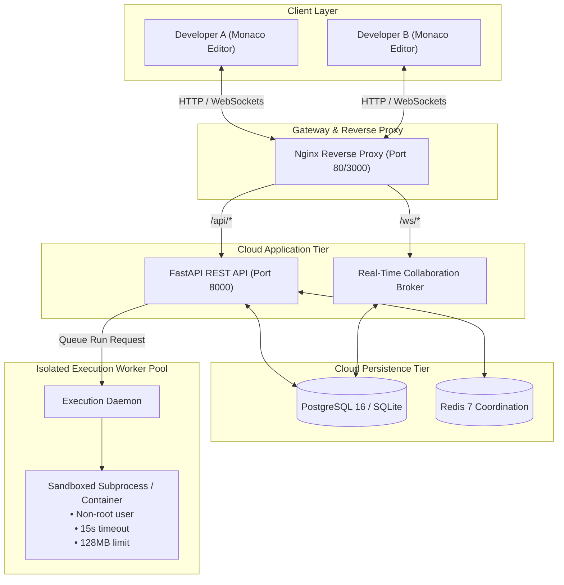

# CloudCode — Cloud-Based Collaborative Code Workspace

[](https://fastapi.tiangolo.com/)
[](https://react.dev/)
[](https://microsoft.github.io/monaco-editor/)
[](https://tailwindcss.com/)
[](https://www.docker.com/)
[](LICENSE)

**CloudCode** is a production-oriented cloud computing development environment inspired by modern browser IDEs like VS Code, Codespaces, and Replit. It enables software teams to create, edit, organize, collaborate on, and execute multi-language coding projects in the cloud.

---

## 1. Problem Statement & Objectives

Traditional local development environments require extensive toolchain setups, manual compiler installations, and disjointed collaboration workflows (emailing files, resolving merge conflicts, or screen-sharing). 

**CloudCode demonstrates key Cloud Computing principles:**
1. **Centralized Cloud Persistence**: Eliminates local dependency barriers; workspace files and versions reside securely in the cloud.
2. **Multi-User Real-Time Collaboration**: Sub-millisecond peer cursor movement and conflict-free text synchronization over WebSockets.
3. **Stateless Scale & Worker Isolation**: Decoupled API servers and isolated execution sandboxes prevent untrusted code from compromising the host or neighbouring tenants.
4. **Resilience & Fault Tolerance**: Automated reconnection, non-destructive snapshot versioning, and debounced transactional persistence.

---

## 2. Key Features

- **Professional Browser IDE**: Dark charcoal theme (`#090d16` / `#0f172a`), line numbers, syntax highlighting, bracket matching, code folding, word wrap, and keyboard shortcuts (`Ctrl+S`, `Ctrl+Enter`).
- **Real-Time Collaboration**: Live remote peer cursors, colored presence badges, participant lists, and simultaneous editing synchronization.
- **Isolated Multi-Language Sandbox**: Asynchronous compilation and execution for Python, JavaScript (Node.js), C, C++, and HTML/Web live preview with 15s timeout limits and 128MB memory caps.
- **Input/Output Terminal**: Standard input (`stdin`) pipeline, `stdout`, `stderr`, exit code inspection, duration metrics, and text export.
- **File Explorer**: Recursive directory management, new file/folder creation, rename, move, and delete protection against path traversal.
- **Granular Access Control**: Project permissions (`Owner`, `Editor`, `Runner`, `Viewer`) and invite workflows with secure tokens.
- **Version History & Checkpoints**: Save snapshots and non-destructively restore any previous version.
- **Project Activity & Comments**: Real-time project discussion threads and activity audit timelines.

---

## 3. Technology Stack

| Layer | Technologies |
|---|---|
| **Frontend** | React 18, Vite, TypeScript, Tailwind CSS, Monaco Editor, Lucide React, Axios, React Router 6 |
| **Backend** | Python 3.11+, FastAPI, SQLAlchemy 2.0 (Async), Pydantic v2, WebSockets, Bcrypt, PyJWT |
| **Database** | PostgreSQL 16 (production) with SQLite (`aiosqlite`) local fallback |
| **Coordination** | Redis 7 & in-memory pub/sub broker |
| **Execution Sandbox** | Dockerized isolated workers & restricted subprocess sandbox with timeout/memory limits |
| **Deployment** | Docker, Docker Compose, Nginx Reverse Proxy |

---

## 4. Architecture Diagram



---

## 5. Quick Start (Local Development)

### Prerequisites
- Python 3.11+
- Node.js 18+ & npm

### Step 1: Start the Backend Server
```bash
cd backend
# Create virtual environment if desired
python -m venv venv
.\venv\Scripts\activate   # Windows
# source venv/bin/activate # Linux/macOS

pip install -r requirements.txt
uvicorn app.main:app --reload --host 127.0.0.1 --port 8000
```
- API Documentation is live at: `http://127.0.0.1:8000/docs`

### Step 2: Start the Frontend Application
```bash
cd frontend
npm install
npm run dev
```
- Open browser at: `http://localhost:5173`

---

## 6. Docker Compose Multi-Container Stack

To run the entire production-grade stack including PostgreSQL, Redis, FastAPI, Nginx, and the Execution Worker:

```bash
# 1. Copy environment template
cp .env.example .env

# 2. Launch all services
docker compose up -d --build

# 3. View running containers
docker compose ps
```

Access points:
- **Web Application**: `http://localhost:3000` (or `http://localhost`)
- **API Swagger Docs**: `http://localhost:8000/docs`
- **PostgreSQL**: `localhost:5432`
- **Redis**: `localhost:6379`

---

## 7. Demo Accounts

The database seeds an administrator account upon first registration. For convenience, two demo accounts can be registered or filled directly from the login page:

| Role | Username | Password | Email |
|---|---|---|---|
| **Administrator & Project Owner** | `alice` | `Password123!` | `alice@cloudcode.io` |
| **Collaborator (Editor)** | `bob` | `Password123!` | `bob@cloudcode.io` |

---

## 8. Supported Languages & Starter Templates

| Language | Extension | Runtime / Compiler | Starter Included |
|---|---|---|---|
| **Python** | `.py` | Python 3.11+ | Prime calculator with CLI output |
| **JavaScript** | `.js` | Node.js 20+ | OS metrics & async tasks |
| **TypeScript** | `.ts` | Node.js / TS-Node | Typed cluster architecture model |
| **HTML / CSS / JS** | `.html` | Browser Sandbox Iframe | Responsive interactive web card |
| **C** | `.c` | GCC / Clang | Loop accumulator & stdio |
| **C++** | `.cpp` | G++ / Clang++ | Modern STL vector summation |

---

## 9. Automated Testing & Verification

Run backend unit and integration tests:
```bash
cd backend
python -m pytest tests/test_api.py -v
```

All 5 core test suites pass:
1. `test_health_check` — System readiness and worker status.
2. `test_auth_workflow` — Registration, JWT creation, password hashing, and role assignment.
3. `test_project_and_file_crud` — Templates, file tree creation, updates, and project duplication.
4. `test_code_execution` — Real Python and Node.js execution sandbox tests.
5. `test_sharing_and_permissions` — Invitations, access control, and membership verification.

Run frontend production build verification:
```bash
cd frontend
npm run build
```

---

## 10. Folder Structure

```
cloudcode/
  ├── backend/
  │   ├── app/
  │   │   ├── api/v1/         # Auth, Projects, Files, Executions, Sharing, Versions, Comments, WS
  │   │   ├── core/           # Security, Config, Dependencies
  │   │   ├── models/         # SQLAlchemy 2.0 models (User, Project, File, Execution, etc.)
  │   │   ├── schemas/        # Pydantic v2 schemas
  │   │   ├── services/       # Project, File, and Execution business logic
  │   │   ├── execution/      # Sandbox runners (Python, Node, C, C++, Web)
  │   │   ├── collaboration/  # WebSocket room & presence manager
  │   │   ├── db/             # Database session & engine
  │   │   └── main.py         # FastAPI application entrypoint
  │   ├── tests/              # Pytest test suite
  │   ├── Dockerfile
  │   └── requirements.txt
  ├── frontend/
  │   ├── src/
  │   │   ├── components/     # Navbar, FileTree, TerminalPanel, RightSidebar, Modals
  │   │   ├── pages/          # Login, Register, Dashboard, Workspace, InviteAccept
  │   │   ├── services/       # API clients for auth, projects, files, executions
  │   │   ├── collaboration/  # useCollaboration hook (WebSocket sync, peer cursors)
  │   │   ├── types/          # TypeScript interfaces
  │   │   ├── App.tsx         # Route definitions
  │   │   └── index.css       # Tailwind directives & Monaco styling
  │   ├── Dockerfile
  │   ├── nginx.conf
  │   ├── package.json
  │   └── vite.config.ts
  ├── execution-worker/
  │   ├── runners/            # Dedicated worker daemon
  │   ├── Dockerfile          # Non-root unprivileged runner container
  │   └── requirements.txt
  ├── docs/                   # Architecture, Database, API, Security, Deployment, Testing
  ├── docker-compose.yml      # Multi-container orchestration
  ├── .env.example
  └── README.md
```

---

## 11. Security & Cloud Considerations

- **Non-Privileged Execution**: Containers run without `--privileged` and do not mount the Docker socket.
- **Isolated Iframe Sandbox**: Web preview uses `sandbox="allow-scripts"` to strictly isolate user scripts from accessing application session tokens or storage.
- **Resource Constraints**: Watchdog timers terminate hanging processes after 15 seconds. Memory is capped at 128MB.
- **Path Traversal Protection**: Directory paths are strictly sanitized to prevent escaping project boundaries.

---

## 12. License

Distributed under the MIT License. Built for Cloud Computing Academic Project Demonstrations.
