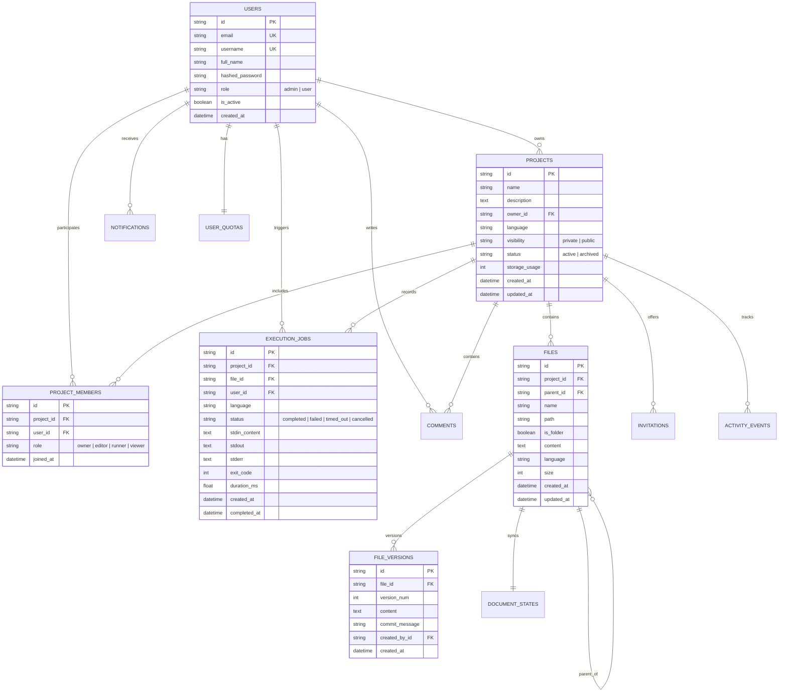

# CloudCode — Database Schema & Data Models

## 1. Relational Database Design Overview

CloudCode utilizes PostgreSQL for production and an asynchronous SQLite driver (`aiosqlite`) for frictionless local development. All models are defined using modern SQLAlchemy 2.0 async paradigms with explicit foreign key cascading, unique constraints, and UTC timestamps.

---

## 2. Entity-Relationship Diagram

---

## 3. Key Model Explanations

1. **`User` & `ProjectMember`**:
   - Implements Role-Based Access Control (RBAC).
   - Global Roles: `admin`, `user`.
   - Project-Level Permissions: `owner` (full administration), `editor` (create/modify files, run code), `runner` (read files and execute), `viewer` (read-only).
2. **`File` & `FileVersion`**:
   - Non-destructive versioning. Restoring a version creates a new incremented revision rather than destroying historical snapshots.
   - Sibling uniqueness is validated by parent directory and project id.
3. **`DocumentState`**:
   - Retains collaborative synchronizations and state vectors for concurrent editing sessions.
4. **`ExecutionJob`**:
   - Retains per-project execution metrics, stdout/stderr, and exit codes capped at 64KB per run.
